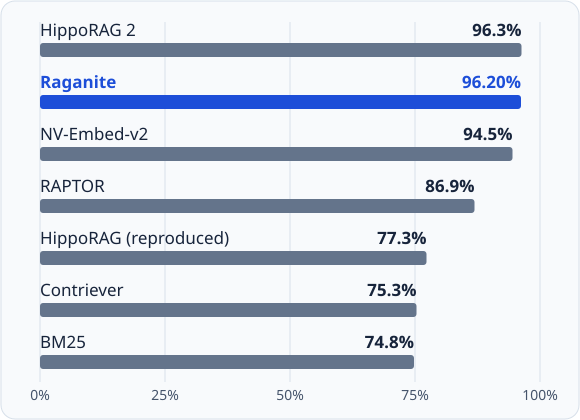
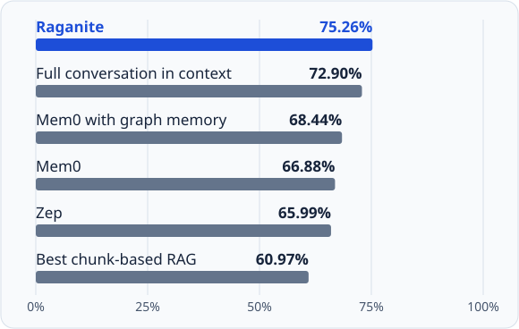

# Benchmark results

Raganite was evaluated on HotpotQA, where retrieval must find supporting Wikipedia pages, and LoCoMo, where the system must answer questions about long conversations. Both runs used Raganite without passage reranking. The embedding models, answer models, and context budgets differed, so the two sets of scores measure different things.

## Results at a glance

| Benchmark | Questions | Supporting-page Recall@5 | Overall answer score | Answer F1 |
| --- | ---: | ---: | ---: | ---: |
| HotpotQA | 1,000 | **96.20%** | 59.00% exact match | 75.26% token F1 |
| LoCoMo | 1,540 | Not measured | **75.26% judge accuracy** | 51.71% token-set F1 |

There is no combined score: HotpotQA exact match and LoCoMo judge accuracy count different things.

## HotpotQA: finding both supporting pages

The run answered **all 1,000 questions with no failures**, using a cached Neo4j graph, `text-embedding-3-large` (3,072 dimensions), and GPT-4o for answer generation. The answer model received the top five retrieved passages.

| Metric | Result |
| --- | ---: |
| Supporting-page Recall@5 | **96.20%** (1,924/2,000 pages) |
| Both supporting pages in the top five | **92.70%** (927/1,000 questions) |
| Answer exact match | **59.00%** (590/1,000 questions) |
| Answer token F1 | **75.26%** |

Recall@5 counts each supporting page separately; the both-pages metric only counts a question if both pages are found. Answer exact match and token F1 measure the generated answer, not retrieval by itself.

### Supporting-page Recall@5 across systems

External scores come from [HippoRAG 2, Table 3](https://arxiv.org/html/2502.14802v1#S3.T3). That table does not report passage recall for GraphRAG or LightRAG. These are reference scores, not a controlled head-to-head comparison: the setups differ, and Raganite's aggregate includes 700 questions used to train its retrieval model.

## LoCoMo: answering from long conversations

The run covered **1,540 non-adversarial questions across 10 conversations**, with 446 adversarial questions excluded to match the Mem0 evaluation protocol's question set. Raganite used `text-embedding-3-small` (1,536 dimensions) and the `gpt-4o-mini` model for answer generation and judging. It used the Mem0 answer and judge prompts, but supplied its own retrieved conversation chunks, up to 60 per question. This was one run, not an average across repeated trials.

| Question type | Judge-correct answers | Answer token-set F1 |
| --- | ---: | ---: |
| Single-hop | 86.68% (729/841) | 59.49% |
| Multi-hop | 65.60% (185/282) | 35.63% |
| Temporal | 62.62% (201/321) | 54.31% |
| Open-domain | 45.83% (44/96) | 22.13% |
| **Overall** | **75.26% (1,159/1,540)** | **51.71%** |

The judge score counts answers deemed correct against the reference; token-set F1 measures word overlap. The lower multi-hop score compared with single-hop shows that questions spanning multiple pieces of evidence remained harder in this run.

### Overall judge accuracy across systems

External scores come from [Mem0, Table 2](https://arxiv.org/html/2504.19413v1#S4.T2). The paper reports means across 10 judge runs; Raganite reports a single pass. These figures are published reference points, not a same-stack comparison.
