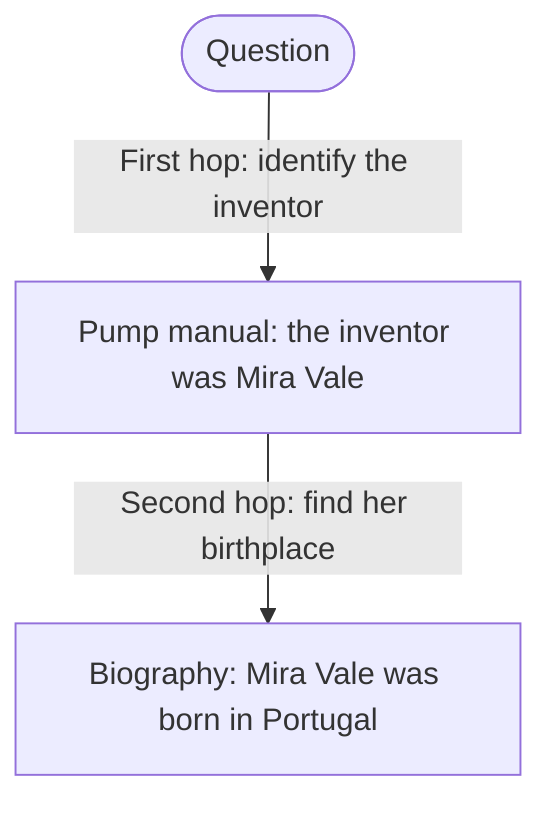
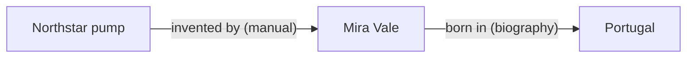
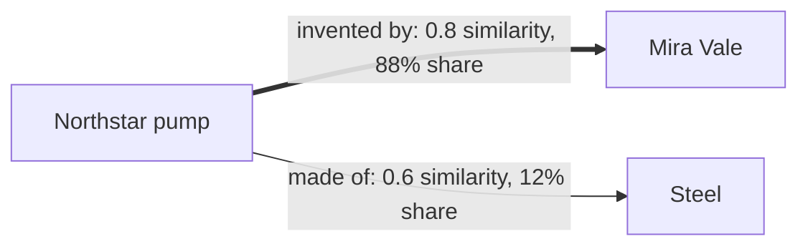
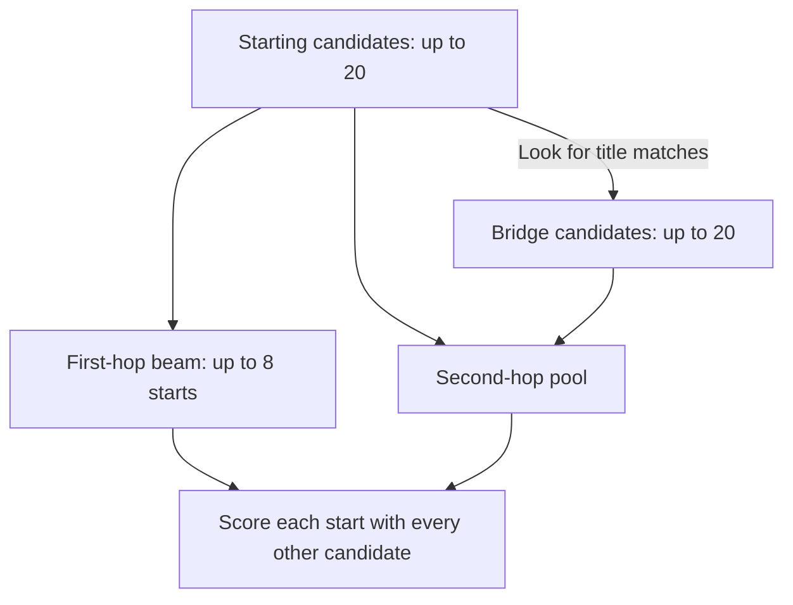
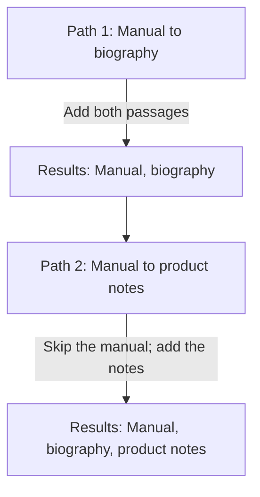

# From documents to answers: how Raganite searches

Imagine you give Raganite a folder of manuals, notes, and articles. Each file is a **document**. Raganite breaks long documents into smaller pieces of original text called **chunks**. When search returns one of those pieces, we call it a **passage**. A passage might be a paragraph from a manual. It is text you can read and check, not a summary or a new answer written by a model.

There are three jobs to keep separate. **Indexing** prepares and saves the documents in a form that can be searched. **Retrieval** looks for passages that help answer a question. **Answer generation** is the optional next step: a model reads the returned passages and writes a reply. You can stop after retrieval and read the source text yourself.

## What does “two-hop” mean?

Suppose you ask, **“In which country was the inventor of the Northstar pump born?”** You have two documents: a pump manual and a biography. Each contains a passage that gives you one part of the answer:

| Where the passage comes from | Original text in the passage | What it tells you |
| --- | --- | --- |
| Northstar pump manual | “Mira Vale was the inventor of the Northstar pump.” | Who invented the pump |
| Biography titled *Mira Vale* | “Mira Vale was born in Portugal.” | Where that person was born |

A **hop** is a step in the search. In the **first hop**, Raganite picks a promising passage for the question, such as the manual. In the **second hop**, it looks for a passage that could help given that specific starting point, such as Mira Vale's biography. The biography may not look relevant on its own because it never mentions the pump. Once you know the inventor's name, the connection is clear.

“Two-hop” describes how Raganite looks for useful **pairs** of passages. It can try several starting points and return more than two passages. The pump and inventor are fictional; the same search steps apply to other documents.

## 1. Build the index before anyone asks a question

The **index** is the collection of searchable records Raganite builds from your documents. Think of it as the original chunks plus a set of notes about what each chunk says and where it came from. Raganite builds it ahead of time, so it does not have to read and analyze your original files again for every question.

1. **Split each document into chunks.** By default, Raganite aims for chunks of up to 1,500 characters, with up to 200 characters of **overlap**. Overlap means some text can appear in two neighboring chunks, so an idea near the end of one chunk keeps some of its context in the next. The search can use a chunk's **title**, such as the document name, to recognize when another chunk refers to it.
2. **Find entities and relationships.** During indexing, a **chat model** (software that reads and generates text) picks out **entities** such as `Northstar pump`, `Mira Vale`, and `Portugal`. A **relationship** says how two entities are connected, such as `born in`. Raganite can recognize the same entity across documents when its name and label match exactly. A **label** is the kind of thing it is, such as `Person` or `Place`.
3. **Store those relationships as facts.** A **fact** here is a searchable statement extracted from the source text. It has a starting entity, a relationship, and an ending entity, for example `Mira Vale | born in | Portugal`. “Fact” does not mean independently verified: the extractor can miss or misread information, and the source itself can be wrong. The original passage is still what the reader can check.
4. **Make text comparable and keep track of where it came from.** An **embedding model** turns each chunk and, by default, each fact statement into an **embedding**: a list of numbers that represents the text's meaning. Raganite stores those numbers alongside the original text. It also stores **provenance**: links that let it trace entities and other records back to the documents that produced them. If the same entity appears in several documents, that information helps the search decide which passages should receive its score.

A **graph** is a collection of things connected by links. The things are called **nodes**; the links are called **edges**. In the fact graph below, each node is an entity and each arrow is a **directed edge**, meaning it points from one entity to another.

The fact graph connects **entities**. The two-hop example connects **pieces of text**. The fact graph helps Raganite find where to start; comparing pairs of passages helps it choose what to return.

## 2. Find promising places to start

When you ask a question, retrieval uses different parts of the same index for different jobs:

| What Raganite stored | How search uses it |
| --- | --- |
| Original chunk text and its title | Match words, find references to other passages, and return text you can read. |
| Chunk embeddings | Find passages that mean something similar to the question, even if they use different words. |
| Fact statements and their embeddings | Work out which relationships matter for this question and guide the walk through the graph. |
| Entities and provenance | Connect information across documents and pass scores from entities back to passages. |

Raganite turns the question into an embedding once. You can picture an embedding as an arrow in a space with many dimensions. Two pieces of text with similar meaning often point in similar directions. **Cosine similarity** measures that alignment: arrows that point the same way score `1`, and arrows at right angles score `0`. This can surface relevant wording even if it doesn't repeat the question exactly.

### Query–embedding similarity

Let $\mathbf{q},\mathbf{x}\in\mathbb{R}^{d}$ be the question embedding and a fact or passage embedding, respectively, each with $d$ coordinates. For nonzero vectors, their **cosine similarity** is the dot product divided by the product of their Euclidean norms (vector lengths):

$$
\operatorname{sim}(\mathbf{q},\mathbf{x})
= \frac{\mathbf{q}^{\mathsf T}\mathbf{x}}
       {\lVert\mathbf{q}\rVert_2\lVert\mathbf{x}\rVert_2},
\qquad
\lVert\mathbf{x}\rVert_2 = \sqrt{\sum_{j=1}^{d}x_j^2}.
\tag{1}
$$

The dot product multiplies matching coordinates and sums the products. Dividing by the lengths makes the score independent of vector magnitude. For example, with $\mathbf{q}=(1,0)$ and $\mathbf{x}=(3,4)$, the dot product is $3$, the lengths are $1$ and $5$, and the similarity is $3/(1\times5)=0.6$.

### Query-conditioned transitions

Let $G=(V,E)$ denote the directed fact graph, with entities $V$ and fact edges $E$. For an edge $e$, write $s_e=\operatorname{sim}(\mathbf{q},\mathbf{x}_e)$, where $\mathbf{x}_e$ is the embedding of its fact sentence. Let $E^{+}(u)$ be the set of edges leaving entity $u$. The walk assigns each such edge a **transition weight** by applying softmax within that set:

$$
a_e(\mathbf{q})
= \frac{\exp(s_e/\tau)}
       {\sum_{f\in E^{+}(u)}\exp(s_f/\tau)},
\qquad e\in E^{+}(u).
\tag{2}
$$

Here $\tau=0.1$ is the default **temperature**. A lower temperature concentrates weight on the highest-scoring edges. For numerical stability, the implementation subtracts the largest scaled score in each group before exponentiating; this leaves the ratios unchanged. The weights sum to one for a node with outgoing edges. They describe where the walk sends its score, not whether the facts are true.

In this example, two arrows leave the pump. The similarity scores are made up.

In Equation (2), $\exp(x)$ means raising Euler's number (about 2.718) to the power $x$. The two scaled scores are $0.8/0.1=8$ and $0.6/0.1=6$:

$$
\begin{aligned}
\text{Inventor link share} &= \frac{e^8}{e^8+e^6} \approx 0.881 \\
\text{Material link share} &= \frac{e^6}{e^8+e^6} \approx 0.119
\end{aligned}
$$

### Personalized PageRank

The **restart distribution** $\mathbf{b}$ assigns starting weight to the endpoints of up to five facts with the highest positive similarities by default. For an entity $v$, let $F_v$ contain one copy of each selected edge per occurrence of $v$ as an endpoint. Let $n_v$ be the number of passages that produced $v$. The unnormalized seed weight $h_v$ is zero if $F_v$ is empty; otherwise it is the mean adjusted similarity:

$$
h_v = \frac{1}{|F_v|}\sum_{e\in F_v}\frac{s_e}{\max(n_v,1)},
\qquad
b_v = \frac{h_v}{\sum_{u\in V} h_u}.
\tag{3}
$$

The normalization applies when there is a positive seed weight. For example, a fact with similarity 0.8 contributes $0.8/4=0.2$ before averaging if four passages produced the entity.

Let $P_{vu}$ be the sum of the weights $a_e$ over edges from $u$ to $v$. Source entities index the **columns** of $P$, so $P\mathbf{m}^{(k)}$ gives the incoming score from links at iteration $k$. Let $D$ be the set of **dangling nodes** (entities with no outgoing edges), and let $\delta_k=\sum_{u\in D}m_u^{(k)}$ be their combined score. Starting from $\mathbf{m}^{(0)}=\mathbf{b}$, the update is

$$
\mathbf{m}^{(k+1)}
= (1-\alpha)\mathbf{b}
  + \alpha\bigl(P\mathbf{m}^{(k)}+\delta_k\mathbf{b}\bigr).
\tag{4}
$$

With damping factor $\alpha=0.85$, 15% of the total score returns to the seeds on every iteration. Of the 85% allocated to the walk, the portion held at dangling nodes also returns to the seeds. For example, if the pump holds 0.50, it sends $0.85\times0.50\times0.881\approx0.374$ to Mira through the inventor link. If $\delta_k=0.20$ and Mira's restart share is 0.40, she also receives $0.85\times0.20\times0.40=0.068$ from dangling nodes and $0.15\times0.40=0.060$ from ordinary restart.

The iteration stops when $\lVert\mathbf{m}^{(k+1)}-\mathbf{m}^{(k)}\rVert_1<10^{-12}$, where $\lVert\cdot\rVert_1$ sums the absolute changes across entities, or after 100 updates. These updates are internal to PageRank and are **not** the two passage hops.

### Projection from entities to passages

That calculation scores entities, not text. To get back to passages, Raganite uses provenance. If Mira has a score of 0.30 and both the manual and biography produced her entity, the biography titled *Mira Vale* gets the full 0.30. If neither title nor filename matches, each gets $0.30/2=0.15$. A passage's walk score is the sum of the shares it receives from all entities. If the index has no provenance for any passages, the walk can still give an entity's score to a matching title or filename.

A **candidate** is a passage being considered, not a result the search has committed to returning. Raganite builds a pool of candidates from the walk scores, similarities between the question and passage embeddings, **BM25** (a word-matching score that gives more weight to rarer words), and passages associated with relevant facts. It keeps up to **20 starting candidates** by default, using the walk score plus a small boost from passage similarity.

That boost ranges from 0 to 0.05 by default. Raganite takes up to 200 passages with the strongest positive similarities. Among those passages, it subtracts the lowest similarity from each score and divides by the difference between the highest and lowest. This puts the scores on a scale from 0 to 1; multiplying by 0.05 gives the boost. For example, if similarities range from 0.40 to 0.80, a passage at 0.60 gets:

$$
\Delta(p)=\lambda\frac{c_p-c_{\min}}{c_{\max}-c_{\min}},
\qquad
0.05\,\frac{0.60-0.40}{0.80-0.40}=0.025.
\tag{5}
$$

Here $c_p$ is the question similarity of passage $p$, $c_{\min}$ and $c_{\max}$ are the extremes among the retained passages, and $\lambda=0.05$ is the default scale. If the extremes coincide, every retained passage gets $\Delta(p)=\lambda$. Passages outside this set get no boost. This contribution is added **after** PageRank; it is not a restart weight.

## 3. Add passages that the first search might miss

Raganite checks whether starting passages mention another passage's title or **alias**, an alternate form of the title. It also checks the reverse: does another passage mention a starting passage's title? It can add up to **20 bridge candidates** this way. A **bridge** is a passage added because of one of these mentions. In the example, the name *Mira Vale* in the manual can bring her biography, titled *Mira Vale*, into consideration even if it would not rank highly on its own.

Next, a learned score keeps up to **eight** starting candidates. This shortlist is the **beam**. Here, the **first hop** picks a starting passage; the **second hop** pairs it with another passage. Each retained starting passage is paired with every other candidate, including bridges. Eight is the number of places the search can start from, not the number of possible second passages.

Let $\mathcal C$ be the candidate pool and $\mathcal B\subseteq\mathcal C$ the first-hop beam. The set of evaluated ordered paths is

$$
\mathcal P=\{(s,t)\in\mathcal B\times\mathcal C:s\ne t\},
\qquad
|\mathcal P|=|\mathcal B|(|\mathcal C|-1).
\tag{6}
$$

The vertical bars denote the number of elements in a set. Excluding self-pairs gives at most $8\times39=312$ paths with the default limits, versus $40\times39=1{,}560$ without the first-hop restriction.

## 4. Score what each second passage adds

For each ordered pair, call the first passage the **source** and the second the **target**. Raganite calculates the **residual terms**: important question words that the source did not cover. The target gets a coverage feature for bringing in some of those words.

| What we check | In the pump example |
| --- | --- |
| Question terms, simplified | `country`, `inventor`, `Northstar`, `pump`, `born` |
| Terms covered by the source (manual) | `inventor`, `Northstar`, `pump` |
| Terms still missing | `country`, `born` |
| Missing terms supplied by the target (biography) | `born` |
| Residual coverage for this pair | One out of two missing terms (50%) |

Here, *Portugal* answers the country part without using the word *country*. This is why exact word overlap is only one clue. Other **features** (numeric clues) measure passage similarity, shared entities, whether one passage mentions the other's title, whether extracted facts connect them and in which direction, and whether the two passages together cover exact years or numbers mentioned in the question. Reversing the order changes what the source covers and what the target adds.

### Source-conditioned coverage

Let $Q$ be the set of distinct normalized question terms after removing common words such as “the.” Let $C_s,C_t\subseteq Q$ be the terms found in the source and target. The **residual** $R_s=Q\setminus C_s$ consists of terms missing from the source. The two coverage features are

$$
\begin{aligned}
\rho_{\mathrm{res}}(s,t) &= \frac{|R_s\cap C_t|}{\max(|R_s|,1)},\\
\rho_{\mathrm{union}}(s,t) &= \frac{|C_s\cup C_t|}{\max(|Q|,1)}.
\end{aligned}
\tag{7}
$$

Intersection ($\cap$) takes the terms common to both sets; union ($\cup$) takes the terms present in either set. The denominator uses a minimum of 1 so an empty set yields zero coverage. Exact number and year coverage restricts the union calculation to the corresponding subset of $Q$. In the example, union coverage is $4/5=80\%$ in either order, but residual coverage is $1/2=50\%$ from manual to biography and $3/4=75\%$ in reverse. Neither feature determines the ranking on its own.

### Learned linear scoring

Let $\boldsymbol{\phi}(\mathbf{q},s,t)\in\mathbb R^m$ be the $m$ raw features of the ordered pair. Each feature is standardized using a center $\mu_j$ and positive scale $\sigma_j$ from the bundled checkpoint. The path score $S$ is the dot product of the standardized features with the learned weight vector $\mathbf{w}$:

$$
z_j=\frac{\phi_j(\mathbf{q},s,t)-\mu_j}{\sigma_j},
\qquad
S(\mathbf{q},s,t)=\mathbf{w}^{\mathsf T}\mathbf{z}
=\sum_{j=1}^{m}w_j z_j.
\tag{8}
$$

Subtracting the center puts each feature relative to a reference value; dividing by its scale adjusts how much a change in the raw feature counts. The scorer multiplies each standardized value by its weight and adds the contributions. The first-hop beam uses the same formula restricted to the source-feature coordinates; full path scoring uses all $m$ coordinates. The bundled parameters were fitted before release using examples with known supporting passages. Raganite does not fit them when indexing or searching your data.

For a small example, suppose the residual-coverage feature has a center of 0.25, a spread of 0.50, and a weight of 2. The manual-to-biography coverage is 0.50, so this one feature contributes:

$$
\frac{0.50-0.25}{0.50}\times 2 = 1.0
$$

Those parameters are illustrative. A feature with a negative weight lowers the score as its standardized value increases. The resulting scores order paths; they are not calibrated probabilities.

## 5. Turn the best paths into passages

The retriever visits paths from highest to lowest score. For each path, it adds the source and then the target, skipping any passage it already added. It stops at the passage limit. If the paths don't fill the list, candidate relevance fills the remaining slots.

The final output is a list of passages, not a generated answer. The walk chooses that list directly, so it is **retrieval**, not **reranking**. A reranker is a separate optional step that reorders passages the search has already selected.

For the passage $p_i$ at position $i$ in the beam's output, the API reports the **reciprocal rank** $\operatorname{score}(p_i)=1/i$. The first passage gets 1.0, the second gets 0.5, and the third gets about 0.33. This is a position-based score, not the learned path score in Equation (8) or a confidence estimate.

## What runs when you ask a question

`retrieve` embeds the question and returns the passages without a chat call by default. `query` runs the same retrieval, then passes those passages to a chat model as **context**: the text the model can use to write the answer.

SQLite and Neo4j are two ways to store the index. A **backend** is the code that reads and writes that database. When Raganite manages the records in either database, it supplies the same kinds of records to the beam search. It reuses a **snapshot**, a copy of the searchable graph records loaded into memory, until the backend reports a change.

See [Indexing](../guides/indexing.md) to load your own documents, [Search and retrieval](../guides/retrieval.md) to ask questions, and [Benchmark results](benchmark-results.md) to see how the search was evaluated.
